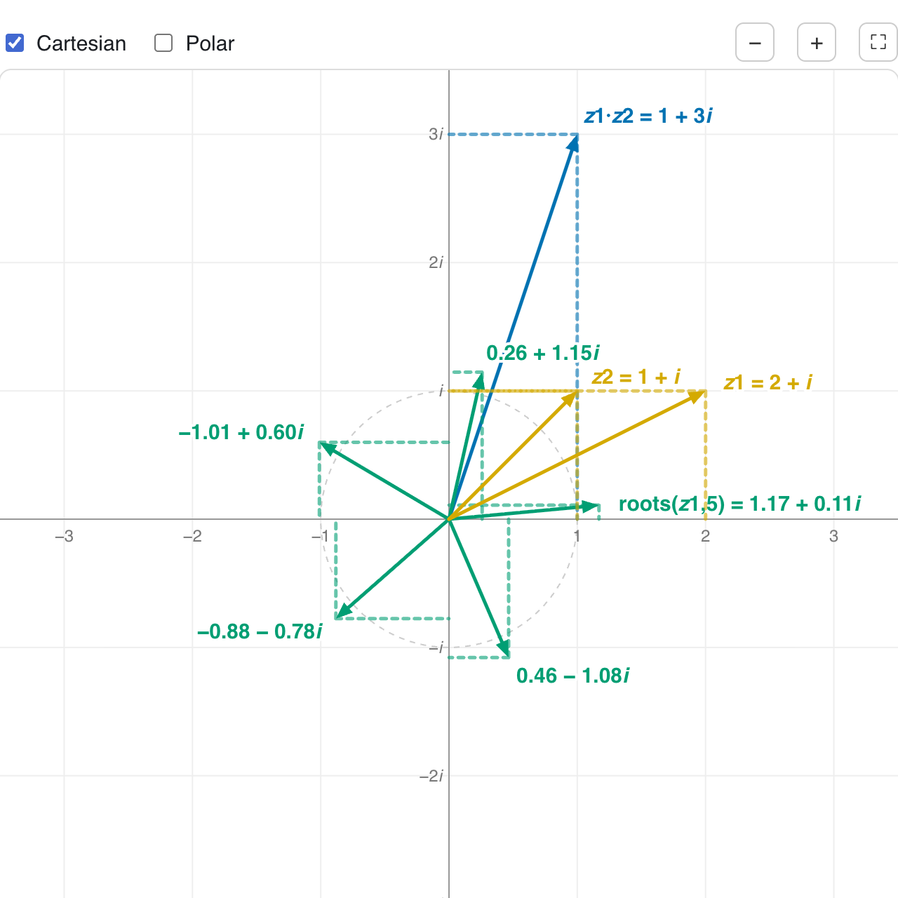

# Maths Widgets

Small, self-contained interactive figures for teaching maths. Each widget is one page, and each page ends with a copy-pastable snippet so you can drop the widget into your own site or LMS, as an iframe or as a script tag that renders it inline.

  <a class="card" href="./complex-playground/">
    <h2>Complex playground</h2>
    
  </a>

